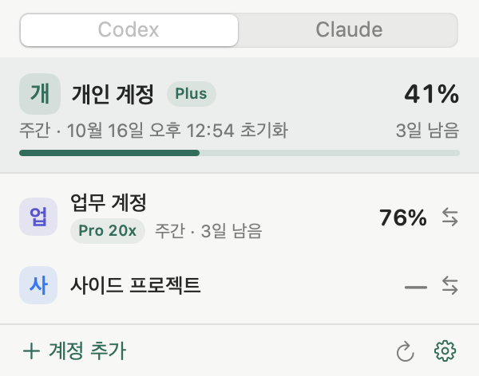
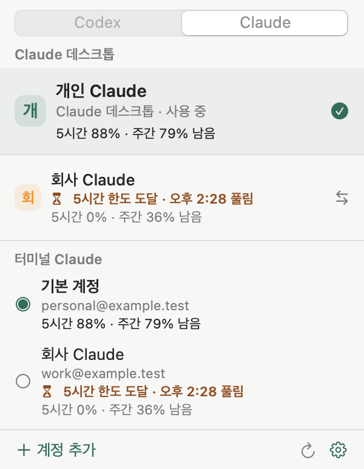

<p align="center"></p>

<p align="center">
  <a href="https://github.com/ChungHyup/pinch-hitter/releases/tag/v0.2.0-beta.1"><b>macOS 다운로드</b></a> ·
  <a href="README.md">English</a> ·
  <a href="https://github.com/ChungHyup/pinch-hitter/issues">문제 제보</a>
</p>

<p align="center">
  
  
  <a href="LICENSE"></a>
  <a href="https://github.com/ChungHyup/pinch-hitter/actions/workflows/ci.yml"></a>
</p>

여러 Codex·Claude 계정을 쓰는 개발자를 위한 작은 macOS 메뉴바 앱입니다. 한 계정의 사용량이 바닥나면 대타(pinch hitter)를 내보내세요. 개인·업무 계정을 모아두고 남은 사용량을 확인한 뒤, Codex·Claude 데스크톱·터미널 Claude Code를 클릭 한 번으로 전환합니다.

*이전 이름: Codex Account Toggle*

**로그아웃을 반복하지 않고, 메뉴바에서 계정을 선택하세요.**

## 작지만 필요한 정보는 모두

<p align="center"> </p>

*가상 계정과 샘플 사용량으로 렌더링한 실제 앱 화면입니다.*

- **로그아웃 없이 계정 추가** — 임시 Codex 홈에서 브라우저로 로그인하고 새 계정을 로컬에 저장합니다.
- **확인 후 계정 전환** — 대상 계정과 재시작 필요 여부를 안내합니다. 기본 버튼은 취소입니다.
- **현재 사용량과 마지막 기록** — 현재 계정은 실시간으로 조회하고, 비활성 계정은 귀속 가능한 로컬 기록이 있을 때만 보여줍니다.
- **크레딧 과금 알림** — 주간 한도를 다 써서 크레딧으로 넘어가면 메뉴 막대가 주황색 $로 바뀝니다. 비즈니스 계정은 월간 크레딧 한도의 남은 %, 개인 계정은 2.8K 같은 잔액을 보여주고, 실제로 크레딧이 차감되는 동안 깜빡입니다. 사용이 막히면 빨간 경고로 바뀝니다.
- **Claude 계정 전환** — 패널의 Claude 탭에서 터미널 `claude` 계정을 즉시 전환하고(계정마다 설정 폴더 하나, 공식 방식), Claude 데스크톱 계정 여러 개를 로그인된 상태로 보관하고 버튼으로 전환합니다. 앱 데이터 폴더의 링크만 바꾸므로 로그아웃이 없고, 전환할 때 Claude가 다시 열립니다. 계정마다 5시간·주간 남은 사용량을 Claude가 남긴 로컬 기록으로 보여주고, 한도에 걸리면 풀리는 시각을 알려 줍니다. [Claude 데스크톱 계정 전환](docs/claude-desktop.md)을 참고하세요.
- **내게 맞는 메뉴** — 계정 이름 변경·저장본 삭제, 메뉴바 잔여량, 한국어·영어, 라이트·다크를 지원합니다.
- **Mac 안에 저장** — 앱 자체 클라우드 동기화·분석 수집 없이 로그인 사본을 로컬에 보관합니다.

## 설치

1. [릴리즈](https://github.com/ChungHyup/pinch-hitter/releases/tag/v0.3.0-beta.1)에서 **Pinch-Hitter-0.3.0-beta.1-universal.dmg**를 다운로드합니다.
2. DMG를 열어 **Pinch Hitter**를 **Applications**로 드래그합니다.
3. 앱을 열고 메뉴바의 순환 화살표 아이콘을 누릅니다.

**이번 버전은 ad-hoc 서명된 베타이며 개발자 서명·공증은 아직 없습니다.** 처음 열 때 macOS가 차단하며, 아래처럼 시스템 설정에서 한 번만 허용하면 됩니다. 조직 정책상 허용할 수 없다면 소스에서 직접 빌드하세요. 자동 업데이트는 없습니다.

**Codex Account Toggle을 쓰고 있었다면** 메뉴바에서 먼저 종료한 뒤 휴지통으로 옮기세요. 저장된 계정은 그대로 쓰고, 실제 계정 모드를 포함한 설정은 첫 실행 때 옮겨 옵니다.

### 처음 열 때 차단되면

이 앱 하나만 허용하는 절차이며 시스템 보안 설정을 전체적으로 낮추지 않습니다.

- **macOS 15(Sequoia) 이상:** 앱을 한 번 열어 "확인할 수 없음" 대화상자를 닫은 뒤 **시스템 설정 → 개인정보 보호 및 보안**으로 가서 아래쪽 보안 항목의 Pinch Hitter 옆 **그래도 열기**를 누르고 확인합니다.
- **macOS 13~14:** 응용 프로그램 폴더에서 앱을 Control-클릭 → **열기** → 대화상자에서 **열기**.
- **터미널로 처리하려면** 이 앱의 다운로드 격리 플래그만 제거합니다.

```sh
xattr -d com.apple.quarantine "/Applications/Pinch Hitter.app"
```

**macOS 13 이상**이 필요합니다. Codex 전환에는 **Codex 데스크톱 앱**이, Claude 탭에는 **Claude 데스크톱**이나 터미널 **Claude Code**가 있어야 합니다. DMG는 Apple Silicon·Intel universal이며 Intel 빌드는 검증했지만 Intel 실기기 QA는 남아 있습니다.

## 실제 계정으로 시작하기

처음 설치하면 데모로 시작합니다. 준비되면 설정 메뉴에서 **실제 계정 모드로 전환**을 선택하세요.

1. **계정 추가 → 현재 로그인 계정 저장**으로 현재 Codex 계정을 저장합니다.
2. **계정 추가 → 다른 계정으로 로그인…**에서 브라우저로 두 번째 계정을 추가하고 이름을 붙입니다.
3. Codex 작업을 마치고 CLI 세션을 종료한 뒤, 전환할 계정을 클릭하고 재시작을 확인합니다.

다른 계정을 추가하려고 Codex에서 로그아웃하지 마세요. 로그아웃은 저장한 인증정보를 무효화할 수 있습니다. 앱은 Codex/CLI를 강제 종료하지 않으며 정상 종료에 실패하면 인증정보 교체 전에 멈춥니다. 전환 후 Codex 내부 계정을 확인하세요.

실제 계정 모드는 다음 실행에도 유지됩니다. 설정에서 데모로 돌아갈 수 있습니다. **파일 기반 ChatGPT 인증**을 대상으로 하며 API 키·Keychain/auto/ephemeral 방식은 지원하지 않습니다.

## 사용량 표시

%는 토큰 개수가 아닌 **남은 사용 한도**입니다. Codex가 제공한 시간 구간만 표시합니다. 비활성 계정의 사용량을 얻기 위해 몰래 전환하거나 로그인하지 않습니다. 과거 기록이 없거나 귀속이 불명확하면 표시하지 않으며, 마지막 확인 시각을 함께 확인해야 합니다. 초기화 날짜는 현재 **한국 시간(KST)** 기준입니다.

현재 계정의 실시간 조회는 짧게 실행하는 `codex app-server`가 담당하며 Codex가 인증정보를 갱신할 수 있습니다. 로컬 세션 파일에서 사용량 이벤트를 추출하고 관련 없는 내용은 버립니다. [사용량 상세](docs/usage.md)를 참고하세요.

## 소스에서 빌드

Xcode Command Line Tools(`xcode-select --install`)와 Swift 5.9 이상이 필요합니다. 외부 Swift 패키지 의존성은 없습니다.

```sh
git clone https://github.com/ChungHyup/pinch-hitter.git
cd pinch-hitter
swift test --disable-sandbox
bash scripts/build-app.sh
open 'dist/Pinch Hitter.app'
```

전체 Xcode가 설치된 환경에서 universal DMG를 만들려면:

```sh
UNIVERSAL=1 bash scripts/build-app.sh
bash scripts/package-dmg.sh
```

[개발·QA 가이드](docs/qa.md) · [이번 릴리즈 검토](docs/release-review-0.2.0.md) · [변경 기록](CHANGELOG.md)

## 보안·기여·라이선스

로그인 사본은 **권한으로 보호된 평문 파일**이며 암호화 저장소가 아닙니다. 폴더는 0700, 파일은 0600이고, 이전 이름과의 호환성을 위해 `~/Library/Application Support/CodexSwitch`에 저장합니다. 해당 폴더와 `auth.json`은 이슈에 올리지 마세요. [보안 안내](SECURITY.md)와 [기여 안내](CONTRIBUTING.md)를 확인하세요.

Windows, 공증 배포, 자동 업데이트는 이번 버전에 포함하지 않습니다. 독립 프로젝트이며 OpenAI의 공식 제품이나 보증을 받은 제품이 아닙니다.

[MIT](LICENSE) © 2026 Chunghyup OH. [ScWen7/CodexSwitch](https://github.com/ScWen7/CodexSwitch)와 [liuzhao1225/codex-account-switcher](https://github.com/liuzhao1225/codex-account-switcher)를 조사했으며 원본 코드·이미지는 번들에 포함하지 않습니다. 로고는 독자적인 벡터 도형으로 생성했습니다. [출처 검토](docs/provenance-review.md)를 참고하세요.
